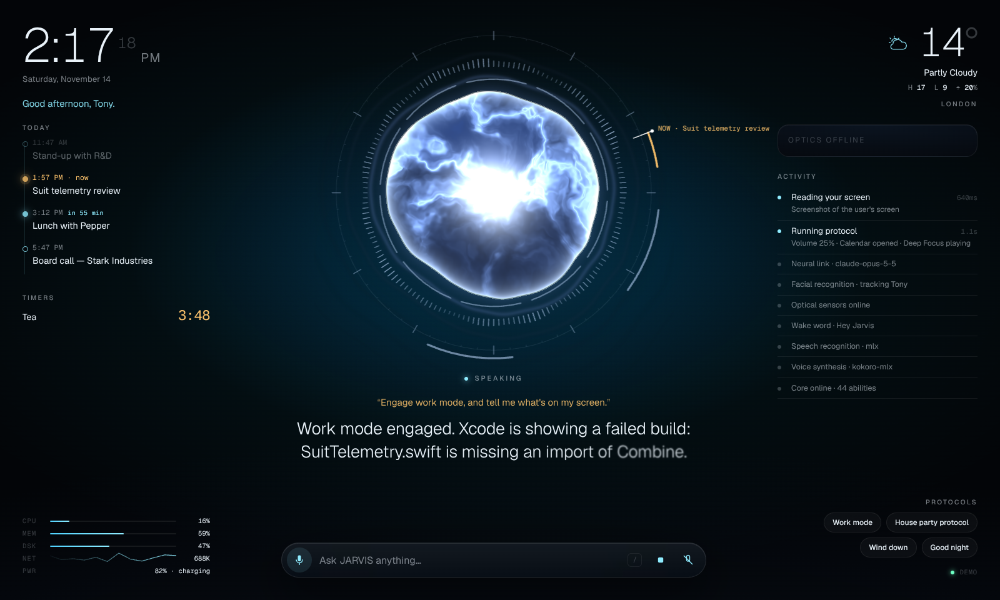

# The look: design language for JARVIS's HUD

The first HUD followed the genre template: Orbitron type, scanlines, a hex grid, boxed
panels and decorative rings. It looked "sci-fi" but generic. This redesign starts from what
the people who designed the film interfaces actually said about their work, and from current
practice in premium UI.



## What the research said

| Source | Lesson | How it shows up |
|---|---|---|
| **Jayse Hansen**, designer of the Avengers Iron Man HUDs ([Pushing Pixels interview](https://www.pushing-pixels.org/2012/06/01/the-craft-of-screen-graphics-and-movie-user-interfaces-conversation-with-jayse-hansen.html), [The Next Web](https://thenextweb.com/news/jayse-hansen-on-creating-tools-the-avengers-use-to-fight-evil-touch-interfaces-and-project-glass)) | *"All the graphics had a purpose."* The director wanted to know what every element was for. Without research the result is "a bunch of circles and random text." | Every ring on the core is an instrument: live audio, work in progress, and a 12-hour dial with your real meetings on it. Nothing is purely decorative. |
| Hansen | Glass screens were designed with "lots of black" so Tony's face stays the focus. | Deep black canvas; the periphery is unboxed text on darkness, with no panels behind it. |
| Hansen | The goal is "a balance between too much data or not enough". Dense data should read at a glance as *patterns*, with detail available on demand. | Peripheral telemetry is small and quiet (hairline bars, a sparkline, a timeline). There is one large thing: JARVIS. |
| Hansen | He rejects "indecisive in-betweenism" and wants committed minimalism or committed maximalism. | Committed minimalism around one maximal centrepiece. |
| Hansen | Design "a bit more advanced than what's current"; nothing dates a film like old tech. | A shader-rendered liquid core and modern type, not 2008 wireframe circles. |
| **Territory Studio**, Age of Ultron's JARVIS screens ([Pushing Pixels](https://www.pushing-pixels.org/?p=9769), [Territory on Medium](https://medium.com/territory-film/fantasy-to-fact-technology-as-a-lens-79e4847803b)) | Whedon wanted the screens showing *constant activity* so JARVIS felt present. Bespoke design avoids formulaic genre conventions. | The core is always alive (breathing, swirling, rippling). Clichés are gone: no Orbitron, scanlines or hex grids. |
| Territory ([Design Week on Blade Runner 2049](https://www.designweek.co.uk/graphic-design-blade-runner-2049-film-dad-festival/)) | Graphics should support the scene, not dominate it. | The periphery stays still and recedes; only the core and live data move. |
| **Apple visionOS / Liquid Glass** ([WWDC23 spatial design notes](https://wwdcnotes.com/documentation/wwdc23-10076-design-for-spatial-user-interfaces/), [legibility on glass](https://www.createwithswift.com/ensuring-interface-legibility-and-contrast-in-visionos)) | Glass creates depth, vibrancy keeps text legible on it, and glass should never be stacked on glass. | Glass appears in exactly three places, all things you touch: the command bar, the authorization sheet, and the notification island. |
| **Modern voice-assistant orbs** ([shader voice orbs](https://21st.dev/@starc007/components/voice-orb), [Rive state guides](https://dev.to/uianimation/how-to-design-an-ai-assistant-ui-using-rive-orbs-avatars-42ci)) | Distinct idle, listening, thinking and speaking behaviours: a subtle pulse at rest, an expanding glow when listening, swirling while thinking, volume-driven while speaking. | The core's shader uniforms are driven by state and by the real mic and voice levels. |

## Anatomy of the core

```
            ┌─ chronometer ring ── 12-hour dial centred on now: hour ticks, a white "now" needle,
            │                      today's meetings as arcs (gold = happening now),
            │                      plus a label for the current or next meeting
            │  ┌─ voice ring ───── 160 radial hairlines driven by the live audio level
            │  │                   (gold = you speaking, ice = JARVIS speaking)
            │  │  ┌─ coil ring ── the arc reactor's ten coils; spin up and show a sweep while working
            │  │  │  ┌─ core ──── WebGL: domain-warped plasma, fresnel rim, white-hot centre,
            ▼  ▼  ▼  ▼            a liquid edge that wobbles with sound, ripples on speech
```

| State | Core | Instruments | Ambient light |
|---|---|---|---|
| Standby | slow breath, gentle swirl | ice, faint | deep blue |
| Listening | brightens, edge ripples with your voice | **gold** | warm gold wash |
| Thinking / executing | swirl speeds up, violet shift | coils spin, progress sweep | indigo |
| Speaking | pulses with his voice, ripples outward | ice, voice ring alive | bright cyan |
| Fault | coral | coral | red |
| Mic muted | desaturated, almost still | grey | slate |

## System

- **Colour has meaning, not mood.** Ice `#8FECFF` = JARVIS. Gold `#FFC46C` = you and anything
  needing your attention (your words, "now", timers, authorization). Coral `#FF6B6B` = fault.
  Mint only on the link LED. Everything else is ink black and white at different opacities.
- **Type.** [Geist](https://vercel.com/font) Light at display sizes (the clock, temperature,
  JARVIS's words) for an engineered, calm voice; Geist Mono for telemetry; wide-tracked small caps
  for section labels. It falls back to SF Pro / SF Mono on a Mac with no network.
- **Motion.** Everything eases out (`cubic-bezier(.2,.8,.2,1)`). Boot is choreographed: the core
  ignites from a point, the instruments draw themselves on, then the periphery fades in, corner by
  corner. Replies appear word by word, coming into focus from a blur. The periphery never moves for
  its own sake.
- **Notifications** use a Dynamic-Island style pill at the top centre instead of corner toasts.
- **Accessibility.** `prefers-reduced-motion` slows the core and removes transitions; text meets
  contrast on black; every control has a label and a keyboard shortcut (Space listen, Esc stop,
  / type).
- **Performance.** One full-screen-quad fragment shader plus a 2D overlay, capped at 2× device
  pixel ratio. No frameworks and no build step. If WebGL is unavailable it falls back to a 2D canvas.

Preview it without the backend:

```bash
jarvis hud --demo
```
