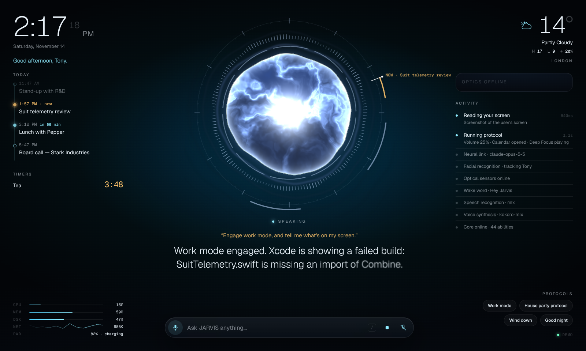
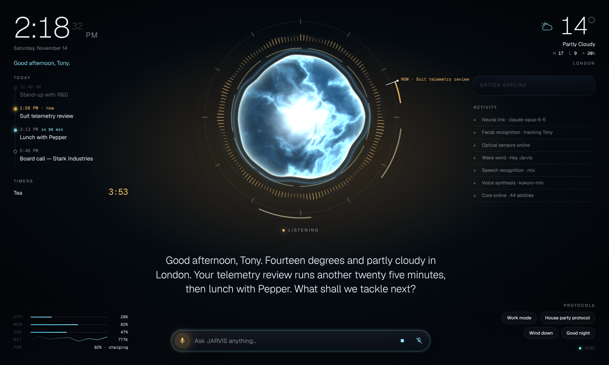

<div align="center">

# J.A.R.V.I.S.
### *Just A Rather Very Intelligent System*, for your Mac

**A voice-first AI that runs your Mac.** Log in and he greets you by the time of day with a
briefing (weather, meetings, reminders, headlines), then asks what you'd like to do.
Say *"Hey Jarvis"* from across the room. He sees you through the camera, knows when you
sit down, reads your hand gestures, and operates your apps, calendar, music, messages,
smart home and terminal. Everything shows on a live, holographic HUD.



 

<sub>Speaking · listening (gold = your voice) · ignition. The design rationale is in <a href="DESIGN.md">DESIGN.md</a>.</sub>

</div>

---

## What he can do

| | |
|---|---|
| 🌅 **Greets you at login** | A greeting that fits the time of day ("Good morning, sir… burning the midnight oil again?") plus a spoken briefing of weather, your next meetings, overdue reminders, unread mail and headlines. Then *"What shall we tackle first?"*, and he listens with no wake word needed. |
| 🔁 **Notices you're back** | Unlock the Mac or simply sit down in front of the camera after time away, and he welcomes you back. The first return of the day gets the full briefing. |
| 🎙️ **Hands-free voice** | Wake word "Hey Jarvis" (openWakeWord), or hold **Right ⌥** to talk. Whisper large-v3-turbo transcribes on your Apple GPU. His **JARVIS voice** (a blend of Kokoro's British George and Fable voices, all on-device) starts within about a second and speaks in whole phrases with natural pauses. Times and units are said the way a person would ("nine tomorrow morning"), and if an answer is slow he says "One moment, sir." instead of leaving silence. Pick another voice, or a free Apple Premium voice such as Jamie, in setup. |
| ✋ **Interrupt anytime** | Say "Jarvis" while he's talking, raise an open palm, or press Esc. After each answer he keeps listening for a few seconds, so follow-ups don't need the wake word. |
| 👁️ **Sees** | "What am I holding?", "How do I look?", "What's on my screen?", "Read this error": camera frames and screenshots go straight to Claude's vision. |
| 🧑‍🚀 **Knows you** | Face recognition (OpenCV YuNet + SFace) tells you apart from visitors. Optional **sentry mode** photographs unknown faces while you're away; optional auto-lock when you leave. |
| 🤚 **Gestures** | Hold a pose: ✋ stop · 👍 / 👎 answer a confirmation · ✌️ start listening · 🤟 play/pause music. Or move: **swipe ← →** for the previous or next track · **flick ↑** to bring up the HUD · **pinch and drag up or down** to turn the volume like a dial · **pinch and drag sideways** to spin the hologram core. A reticle on the HUD follows your hand, so you can see what he sees. |
| 🖱️ **Air mouse** | Part of hand control: hold ☝️ for half a second and the Mac's pointer follows your fingertip, a pinch clicks (pinch and move drags), ✋ stops. |
| 🫧 **Mini JARVIS** | Minimise or close the window (or ⌘H) and a small floating capsule stays on screen: his state, the line he's saying, your next meeting. It floats over every Space and full-screen apps, never takes focus, opens top-centre clear of notifications and the Dock, and remembers where you drag it. Click it to bring the HUD back. |
| 🔐 **Walk away, come back** | With "Lock the Mac when I leave" on, he locks when you walk off and wakes the screen when he recognises you again. Unlocking stays with macOS (Apple Watch, Touch ID or your password): he never stores or types your password. |
| ✉️ **Email** | "Anything in my email that needs me?" He reads unread mail from Apple Mail (Gmail, iCloud, Outlook, work: any account added in System Settings › Internet Accounts), ranks it on your Mac, and tells you the **top 3** that need you: who, what, and a suggested next step. "Read me the second one" or "open it" works too. If Mail is open, his morning greeting mentions anything urgent. No passwords; macOS asks once before he may read Mail. |
| 👁️ **Attention** | He notices whether you're facing the screen: the HUD's side panels rest when you look away and wake when you look back. |
| 🖥️ **Runs your Mac** | Opens and quits apps, volume, brightness, dark mode, lock, sleep, notifications, clipboard, typing, Spotlight file search, reading files, Finder, screenshots |
| 📅 **Your life** | Calendar (read and create), Reminders (they sync to your iPhone), Contacts, iMessage, Notes, unread Mail |
| 🎵 **Music** | Plays songs, artists and playlists in Music or Spotify; play, pause, skip, "what's playing?" |
| 🏠 **Smart home & everything else** | Runs any **macOS Shortcut**, which covers HomeKit scenes, lights, thermostats, Focus modes and any app with Shortcuts actions |
| 🛠️ **Developer mode** | Shell commands (confirmed first), AppleScript, git and brew |
| 🌐 **Knows the world** | Live **web search**, weather (Open-Meteo, no key), news headlines |
| ⏱️ **Time** | Timers and spoken alarms. He also warns you 10 minutes before meetings and when the battery runs low. |
| 🧠 **Remembers** | Long-term memory of your preferences and people ("I take my coffee black"), plus summaries of past conversations |
| 🎛️ **Protocols** | Your own named routines, e.g. *"Jarvis, engage house party protocol"* (see below) |
| 🔌 **Extensible** | Plug in any **MCP server** (GitHub, Notion, Home Assistant, databases…) with three lines of config |
| 🛡️ **Asks first** | Before sending messages, running commands or deleting things he asks *"Shall I…?"* You answer by voice, 👍 or the HUD button. |
| 📴 **Works offline** | Falls back to a local Ollama model if the internet drops |

---


## iPhone & iPad companion

Choose **Pair iPhone or iPad…** in the menu-bar icon, turn the companion on, and scan the QR code
with your iPhone's or iPad's Camera. The JARVIS companion opens in Safari; use **Share ▸ Add to
Home Screen** for a full-screen app. From it you can ask anything (type, or use the keyboard's 🎤
dictation key), answer his "Shall I…?" questions, run protocols, see what he's saying as subtitles,
and stop, mute, switch hand control, lock the Mac or bring JARVIS up on its screen.

It works on your home Wi-Fi only. Each QR code expires after 10 minutes, each device gets its own
key (forget one or all on the pairing screen), only devices on a private network are answered, and
the camera feed never leaves the Mac. The first time, macOS may ask whether JARVIS can accept
incoming connections: allow it.

## Built-in protocols

Say *"Jarvis, engage …"* (or any alias) or tap one on the HUD (**More** lists them all).

| Protocol | Say | What happens |
|---|---|---|
| Work mode | "work mode" | Volume 25, Calendar, focus music, a rundown of your next events |
| House party | "house party protocol" | Dark mode, volume 70, party music |
| Wind down | "wind down" | Pause music; tomorrow morning and open reminders |
| Good night | "good night" | Pause, then lock the Mac |
| Morning | "good morning" | Weather (jacket or not), first events, unread mail, reminders |
| Meeting mode | "I'm going into a meeting" | Pause, volume 15, who's in your next meeting and its link |
| Presentation mode | "showtime" | Quit Messages, Mail, Slack, WhatsApp; hide every other window |
| Focus sprint | "pomodoro" | Focus music and a 25-minute timer |
| Break time | "take a break" | Pause, a 5-minute timer, display off |
| Declutter | "clear my screen" | Hide every window except JARVIS |
| Movie night | "movie night" | Dark mode, dimmer screen, volume 60, hand control on |
| Hands on | "gesture mode" | Hand control on |
| Lockdown | "be right back" | Pause, mute, lock |

Make your own in `protocols.yaml` in JARVIS's data folder (the file explains every step type).
Yours sit alongside the built-ins; add `disabled: true` to hide one, `pinned: true` to put one on the HUD.

## Gesture guide

**Hand control is off until you ask for it.** Say *"Jarvis, hand control on"*, click the ✋ button
on the HUD's command bar, use **Hand Control On / Off** in the menu bar, or flip it in Settings. It
covers everything below, including the air mouse, and switches itself off after 10 minutes without
seeing a hand (or say *"hand control off"*).

JARVIS watches for one hand in front of the camera. A ring on the HUD follows your fingertip so you
can see what he sees (it turns gold while you pinch). Gestures work from your normal seat, about an
arm's length from the camera; keep your hand in the middle of the camera's view and in decent light.

**Hold a pose** (keep your hand still for about half a second)

| Pose | What it does |
|---|---|
| ✋ Open palm | Stop: he stops talking. If he's asking "Shall I…?", it means no. Otherwise it pauses music |
| 👍 Thumb up | Yes, to a "Shall I…?" question |
| 👎 Thumb down | No, to a "Shall I…?" question |
| ✌️ Victory | Start listening, no wake word needed |
| 🤟 "I love you" sign | Play or pause music |

**Move your hand**

| Motion | What it does |
|---|---|
| Swipe → (quick sweep to your right, open hand) | Next track |
| Swipe ← (quick sweep to your left) | Previous track |
| Flick ↑ (quick upward flick) | Bring the JARVIS window to the front |
| Pinch thumb and index, drag up or down | Volume dial: up is louder. A gold arc around the core shows the level |
| Pinch, drag sideways | Spin the hologram core |

**Air mouse** (part of hand control; moving the pointer needs the Accessibility permission)

| Do this | What happens |
|---|---|
| ☝️ Point up, hold half a second | Air mouse on: the Mac's pointer follows your fingertip |
| Pinch | Click |
| Pinch, move, release | Drag |
| ✋ Open palm, hold half a second (or take your hand away for 2 s) | Air mouse off |

While the air mouse is on, swipes and the volume dial pause so nothing fights over your hand.

**Tips**

- Swipes need speed: a sweep of about a fifth of the camera's width in under half a second. Slow drifting never counts.
- Poses only count while your hand is still, so a swipe can't be read as ✋ "stop".
- After a swipe there's a short pause (under a second) before the next one counts.
- If nothing reacts, check the HUD: no ring means the camera can't see your hand (move it into the middle, add light).

## Install (Apple Silicon Mac, macOS 14 or later)

JARVIS is a normal Mac app. Install it **one** of these two ways:

**A. One line (recommended, no security prompts).** Open Terminal, paste this, press Return:

```bash
curl -fsSL https://raw.githubusercontent.com/BireshwarChakravarty/JarvisServer/claude/eager-newton-yifemd/scripts/install-app.sh | bash
```

**Updating:** choose **Update JARVIS…** in the menu-bar icon, or say *"update yourself"*. It runs the
same installer, which keeps every permission.

**Start completely fresh:** this removes JARVIS, its settings, face data, memory and downloaded
models, and every permission it was given, then installs clean (Claude Code and your Claude sign-in
are separate and left alone):

```bash
curl -fsSL https://raw.githubusercontent.com/BireshwarChakravarty/JarvisServer/claude/eager-newton-yifemd/scripts/install-app.sh | bash -s -- --fresh
```

**B. Download.** Get `JARVIS-macOS-AppleSilicon.dmg` from the
[latest release](https://github.com/BireshwarChakravarty/JarvisServer/releases/tag/jarvis-latest), open it and drag
JARVIS to Applications. The first time you open it, macOS says it can't verify the developer, because the app isn't
notarized with a paid Apple Developer ID. Clear the download quarantine once in Terminal:

```bash
xattr -dr com.apple.quarantine /Applications/JARVIS.app
```

or go to **System Settings › Privacy & Security**, scroll down and click **Open Anyway**. You only do this once.
(The one-line installer in A does this for you.)

Either way, JARVIS opens straight into a **guided setup**. Nothing else is done by hand:

| Step | What happens |
|---|---|
| Welcome | JARVIS introduces himself. If he isn't in Applications yet he offers to move himself. His voice and hearing start downloading in the background (about 900 MB, once). |
| You | Your name, how he should address you (sir / ma'am / boss / your name), and your city, with autocomplete. |
| Intelligence | Paste an Anthropic API key (there's a button that opens the right page). He checks it with a live call and stores it in your **Keychain**. |
| Senses | One **Allow all** button triggers each macOS permission dialog in turn: microphone, camera, calendars, reminders, contacts, app control. Status updates live. Screen recording and Accessibility are optional. |
| Recognition | Pick your camera (a Mac mini has none built in), then a live view learns your face in about 5 seconds. |
| Listening | Pick your microphone, then say “Hey Jarvis”. He confirms he heard you. |
| Voice | Tap a voice to hear it: JARVIS (recommended), George, Fable, Lewis, Emma, or an Apple Premium voice you've downloaded. |
| Ready | Start at login (on by default), lock-when-away, sentry mode. **Launch JARVIS** and the HUD takes over. |

Change any of it later from **Settings** (the gear on the HUD, or the menu-bar icon). Closing the window keeps JARVIS
running in the background. Click the Dock or menu-bar icon to bring him back; ⌘Q quits.

Every build is made on an Apple Silicon Mac in [CI](.github/workflows/macos-app.yml) and only published after an
end-to-end **self-test inside the built app** passes. The self-test checks that the native frameworks load, the models
download, his voice speaks "Hey Jarvis, what time is it in London?", the wake-word engine hears it, Whisper
transcribes it back correctly, the vision models run, and the setup screens serve.

<details><summary>Developers: run from source</summary>

```bash
./install.sh        # creates .venv and installs everything
```

```bash
jarvis app          # the same window + onboarding as the packaged app
```

```bash
jarvis              # classic mode (HUD in a window, setup via `jarvis setup`)
```

Build the app yourself with `pip install briefcase` and then `briefcase build macOS`.
</details>

## Talking to JARVIS

> **"Hey Jarvis…"**

- *"What's my day look like?"* · *"Add lunch with Pepper tomorrow at one."* · *"Remind me to call Pepper at six."*
- *"Play some AC/DC."* · *"Next track."* · *"Turn it down to 20."*
- *"Text Happy that I'm running ten minutes late."* → *"Shall I send Happy the message…?"* → 👍
- *"What's on my screen?"* · *"Why is this build failing?"* · *"Summarise this article."*
- *"What am I holding?"* · *"Do I look presentable?"*
- *"Set a pasta timer for 9 minutes."* · *"Wake me at 7:30."*
- *"Run the Movie Night shortcut."* · *"Turn on the living room lights."* (through Shortcuts / HomeKit)
- *"How's the system doing?"* · *"How much disk space have I got?"* · *"What's eating my memory?"*
- *"Run git status in my projects folder."* (confirmed first)
- *"Remember that my sister's name is Priya."* · *"What do you know about me?"*
- *"Engage work mode."* · *"House party protocol."* · *"Good night, Jarvis."*
- *"That's all, thanks."* ends the conversation.

You can also type into the HUD's command bar. The HUD's centrepiece is the core: its rings show live audio, work in progress, and a dial of your next 12 hours with meetings drawn on it ([DESIGN.md](DESIGN.md)). Shortcuts: **Space** listens, **Esc** stops, **/** focuses the command bar. **⌘⇧J** shows or hides the HUD.

---

## Protocols (your own routines)

Edit `~/.jarvis/protocols.yaml`:

```yaml
house_party_protocol:
  aliases: ["house party protocol", "party mode"]
  say: "House party protocol, initiated."
  steps:
    - shortcut: "Party Lights"      # a HomeKit scene in the Shortcuts app
    - dark_mode: true
    - volume: 70
    - music: "Party"

work_mode:
  aliases: ["work mode", "let's get to work"]
  say: "Work mode engaged."
  steps:
    - shortcut: "Focus: Work"
    - open_app: "Visual Studio Code"
    - open_url: "https://github.com/notifications"
    - music: "Deep Focus"
    - ask: "Give me a ten second rundown of my next three meetings."
```

Step types: `open_app`, `quit_app`, `open_url`, `shortcut`, `volume`, `brightness`, `dark_mode`,
`music`, `media`, `notify`, `say`, `wait`, `applescript`, `shell`, `lock_screen`, and `ask`, which hands any
request to JARVIS's brain after the routine. Protocols also appear as buttons on the HUD.

---

## Configuration

Everything lives in `~/.jarvis/config.yaml`. It's deep-merged over
[`jarvis/config/default.yaml`](jarvis/config/default.yaml), so only include what you change:

```yaml
owner: { name: "Tony", title: "sir" }
location: { city: "Malibu", units: imperial }
brain:
  model: claude-opus-5-5   # the default
  effort: low              # low = snappiest spoken replies
  fast_mode: false         # up to ~2.5x faster output, premium pricing
voice:
  tts: { voice: jarvis }       # preset (jarvis, george, fable, lewis, emma) or a blend: "bm_george:0.6,bm_fable:0.4"
  push_to_talk_key: alt_r
vision:
  sentry_mode: true
  auto_lock_when_away: true
mcp_servers:
  github:
    command: npx
    args: ["-y", "@modelcontextprotocol/server-github"]
    env: { GITHUB_PERSONAL_ACCESS_TOKEN: "…" }
```

### Commands

| Command | |
|---|---|
| `jarvis` | Start everything: voice, camera, HUD window |
| `jarvis run --browser` | HUD in your browser instead of a native window |
| `jarvis run --text` | No mic or camera; use the HUD's command bar |
| `jarvis chat [--speak]` | Text chat in the terminal (good for testing tools) |
| `jarvis setup` | First-time wizard |
| `jarvis enroll [--name Pepper]` | Teach JARVIS a face (run again to improve accuracy) |
| `jarvis doctor [--online]` | Diagnose the install, optionally with a live API test |
| `jarvis say "Good evening, sir."` | Hear the voice |
| `jarvis install` / `uninstall` | Start at login (JARVIS.app + Login Item) / stop starting at login. `--launchd` uses a LaunchAgent instead |
| `jarvis hud --demo` | Preview the HUD with simulated data |
| `jarvis devices` | List audio devices (set `voice.input_device` by name) |

---

## How it works

```
                          ┌──────────────── JARVIS.app (Login Item) ─────────────────┐
  mic ─► openWakeWord ─┐  │                                                          │
        "hey jarvis"   ├─►│  Orchestrator (state machine)                            │
  ⌥ hold / ✌️ / HUD ───┘  │   standby → listening → transcribing → thinking → speaking│
                          │        ▲            │ VAD endpointing                    │
                          │        └ follow-up ─┘ mlx-whisper large-v3-turbo         │
                          │                                                          │
  camera ─► YuNet/SFace ─►│  Presence ─► "welcome back" · sentry · auto-lock         │
          └► MediaPipe ──►│  Gestures ─► poses, swipes, pinch-dial, hologram spin   │
                          │                                                          │
  login / unlock (Quartz)►│  Greeter ─► briefing (weather·calendar·reminders·mail·news)
                          │                                                          │
                          │  Brain: Claude Opus 5.5, streaming tool loop             │
                          │    ├─ 44 built-in tools (macOS, PIM, media, vision, memory…)
                          │    ├─ server-side web search                             │
                          │    ├─ MCP bridge (any MCP server)                        │
                          │    └─ prompt-cached, append-only sessions + summaries    │
                          │        │ sentence-by-sentence                            │
                          │        ▼                                                 │
                          │  Kokoro TTS (JARVIS blend) ─► speaker (interruptible)    │
                          │                                                          │
                          │  Event bus ─► FastAPI + WebSocket ─► HUD (pywebview)     │
                          └──────────────────────────────────────────────────────────┘
                   ~/.jarvis: config.yaml · .env · memory.db · faces/ · models/ · protocols.yaml
```

| Path | Role |
|---|---|
| `jarvis/core/orchestrator.py` | The voice state machine, greetings, presence, confirmations, announcements |
| `jarvis/core/brain.py` | Streaming Claude agent loop: parallel tools, sentence streaming, session roll-over and summaries, offline fallback |
| `jarvis/core/persona.py` | JARVIS's personality and voice-first system prompt |
| `jarvis/core/briefing.py` | Parallel gathering of briefing data with tight timeouts |
| `jarvis/core/memory.py` | SQLite + FTS5 long-term memory, transcripts, summaries |
| `jarvis/core/protocols.py` | YAML routines |
| `jarvis/core/scheduler.py` | Timers, alarms, meeting and battery alerts |
| `jarvis/voice/` | Mic, wake word, VAD, Whisper STT, Kokoro / `say` TTS |
| `jarvis/vision/` | Camera, faces, presence, gestures |
| `jarvis/mac/` | AppleScript/JXA, EventKit, Shortcuts, session lock detection, the .app builder |
| `jarvis/tools/` | Tool registry (schemas, validation, confirmation gating), built-in tools, MCP bridge |
| `jarvis/hud/` | FastAPI server and the HUD: a WebGL arc-reactor core plus vanilla JS, no build step ([design notes](DESIGN.md)) |

### Design notes
- **Latency.** Speech starts when the *first sentence* of the reply is ready, not the whole reply. Effort `low` keeps
  thinking short for conversation. The frozen system prompt, tools and history are prompt-cached.
  Kokoro synthesises the next sentence while the current one plays.
- **Sessions.** Each conversation is append-only, which keeps the cache warm and the API's
  thinking-block checks happy. After 15 idle minutes (or 40 turns) the conversation is summarised into
  memory and a new one starts, seeded with your long-term facts and recent summaries.
- **Safety.** Risky tools are marked in code and can't run without your confirmation. File reads are confined
  to your home folder. Shell access can be disabled or allow-listed (`safety.*`).
- **Privacy.** Wake word, speech recognition, voice, face recognition and gestures all run **on your Mac**.
  What goes to Anthropic: your transcribed requests, tool results, and images *only when* he's asked to look
  at the camera or the screen. Face data never leaves `~/.jarvis/faces`.

### Cost
A typical spoken exchange is a few thousand input tokens, mostly cached, and a short reply. On Claude Opus 5.5
($4 / $20 per million tokens, cache reads $0.20) that's a fraction of a cent per request. To spend less, set
`brain.model: claude-sonnet-5-5` or `claude-haiku-5-5` in your config.

---

## Development

```bash
.venv/bin/pip install -e ".[dev]"
```

```bash
.venv/bin/pytest
```

The test suite runs anywhere, Linux CI included. It covers the tool registry and validation, the sentence
streamer, memory, protocols, presence, the scheduler, the HUD server, the full voice state machine with
synthetic audio, spoken confirmations, the offline greeting fallback, and a **contract test that drives the
real Anthropic SDK against a local mock of the Messages API**.

See [RESEARCH.md](RESEARCH.md) for the projects surveyed and what was taken from each.

### Troubleshooting
- **A permission shows ON in System Settings but JARVIS says it's missing.** That copy was installed by
  dragging from the disk image, so macOS treats each update as a new app. Reinstall with the one-line
  installer (or **Update JARVIS…** in the menu bar): it signs JARVIS with this Mac's own identity so
  permissions stick from then on.
- **Screen Recording is allowed but "What's on my screen?" still fails.** macOS only hands that
  permission to a running app after a relaunch: use **Relaunch to apply** in Settings › Senses.
- **He doesn't lock when you walk away.** Turn on Settings › Ready › *Lock the Mac when I leave*, make sure
  he has learned your face (Settings › Recognition), and note he won't lock while the keyboard or mouse is
  in use. He wakes the screen when you return; unlocking stays with Touch ID, Apple Watch or your password.
- **Gestures do nothing.** Hand control is off until you ask: say "hand control on" or press ✋ on the HUD.
- **He doesn't hear "Hey Jarvis".** Run `jarvis doctor`, check the Microphone permission, and try `voice.wake_threshold: 0.35`.
  Holding Right ⌥ always works.
- **Calendar is empty.** Inside JARVIS.app he uses EventKit (grant Calendars). From a terminal he uses AppleScript
  (grant Automation › Calendar).
- **No camera feed.** Grant the Camera permission and check `vision.camera_index` (1 is often an iPhone with Continuity Camera).
- **Logs** are in `~/.jarvis/jarvis.log`.

<div align="center"><sub>Not affiliated with Marvel. JARVIS is a fan tribute; the code is MIT.</sub></div>
